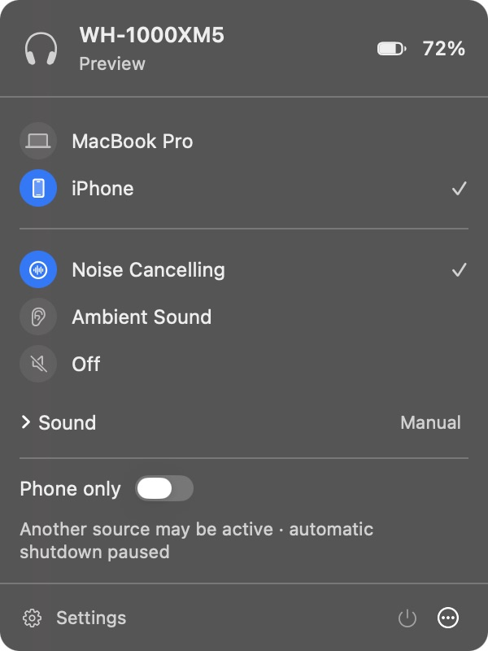

<div align="center">
  <h1>Headroom</h1>
  <p><b>Your Sony headphones, one click away. Noise control, equalizer and better Mac + iPhone handoffs in a tiny native menu bar app.</b></p>
  <a href="https://github.com/Batuhan1999/headroom/releases/latest"></a>
  
  
  <a href="LICENSE"></a>
</div>

<p align="center">
  
</p>

Headroom is for **Sony WH-1000XM5 over-ear headphones on a Mac**, especially when you also use an iPhone. It talks directly to the headphones over Bluetooth. No account, server, Electron or third-party runtime.

## Features

- **Noise control** — Noise Cancelling, Ambient Sound and Off, ambient level and Focus on Voice.
- **Shape your sound** — Sony EQ presets, five bands and Clear Bass, plus DSEE Extreme. The EQ lives inside the dropdown.
- **Mac + iPhone** — choose the audio source, release a silent Mac stream so the phone can play, and keep the Mac fully disconnected with Phone Only.
- **Backpack protection** — release the Mac connection when it locks, sleeps or closes its lid. Reconnect after wake with bounded retries.
- **Silence power-off** — a configurable timer checks headphone playback, Mac output levels and call activity. Keep Headphones On pauses it for quiet ANC use.
- **Headphone settings** — Speak-to-Chat, sensitivity and duration, pause when taken off, built-in power-off and NC/AMB button behavior. Only reported settings appear.
- **Hear yourself on calls** — optionally switch to Ambient during calls or Mac microphone use, then restore the previous mode. A manual change wins.
- **Battery at a glance** — optional percentage beside the menu bar icon and alerts at 20%, 10% and 5%.
- **Shortcuts** — optional ⌃⌥⌘N mode cycling, mode-change pop-up and links for Shortcuts, Raycast and Alfred.
- **Out of the way** — a native dropdown, no Dock icon, optional Open at Login.

## Quick start

1. Download **Headroom-macOS-arm64.zip** from [Releases](https://github.com/Batuhan1999/headroom/releases/latest), unzip it and move **Headroom.app** to Applications. The prebuilt beta is for Apple Silicon; Intel Macs can build from source.
2. Pair and connect the WH-1000XM5 in macOS Bluetooth settings. Allow Headroom to use Bluetooth.
3. Open Headroom and click its headphones icon. Turn on **Open at login** in the **…** menu if wanted.
4. For silence detection and silent-stream handoffs, enable **Measure headphone audio levels** in Settings and allow macOS **System Audio Recording** access. The access check plays a short quiet tone.
5. Before enabling multipoint auto-off, use **Check iPhone playback**: play on the phone, then pause. This verifies the headset's remote playback reports for your phone and firmware.

The beta download is ad-hoc signed, **not notarized**. macOS may require you to approve it in Privacy & Security. If you prefer, build it locally using Xcode's command-line tools.

## How switching works

After the Mac stays silent, Headroom releases its output while keeping the Bluetooth control channel open. Fresh Mac audio can interrupt phone playback and select the Mac again. It requires two seconds of preceding Mac silence and one second of sustained audio; a continuous Mac stream does not repeatedly steal playback back. Phone playback can take over again through Sony multipoint. A source button is an explicit handoff: it can pause the previous source, requests the selected device, and reports a rejection instead of claiming success. Calls block source switching.

**Phone Only** disconnects the Mac completely. **Keep Headphones On** pauses Headroom's timer; it does not change Sony's separate built-in wearing timer.

## Power-off limits

The silence timer runs only while **this Mac is awake, Headroom is running and the headphones are connected to it**. It cannot shut them down while the Mac is asleep, off or fully disconnected in Phone Only mode. Phone audio is observed through Sony's playback reports; Headroom does not read audio from the iPhone.

Unknown or stale playback, call activity and unverified multipoint reporting pause the countdown. Power-off gets a final fresh status check. Sony's built-in **When taken off** setting works independently of the Mac; the WH-1000XM5 does not expose an independent silence timer through this setting.

## Shortcuts and scripts

Turn on **Switch modes with ⌃⌥⌘N** in Settings to cycle Noise Cancelling → Ambient → Off from any app. No Accessibility permission is needed.

With Headroom running and connected, these links work in Shortcuts, Raycast, Alfred or Terminal:

```sh
open headroom://mode/next
open headroom://mode/noise-cancelling
open headroom://mode/ambient
open headroom://mode/off
```

## Build

Requires macOS 14.2+ and Swift 6 / Xcode 16 or newer. There are **no package dependencies**.

```sh
git clone https://github.com/Batuhan1999/headroom.git
cd headroom
swift test
bash scripts/build.sh
open dist/Headroom.app
```

The default build is ad-hoc signed. For a consistent local signing identity, set `SIGNING_IDENTITY` when building. Changing the code signature may make macOS ask for audio access again. `HEADROOM_BUILD_DIR` optionally places build intermediates outside the repository.

See [Development](docs/DEVELOPMENT.md) for the architecture, validation and scope.

## Something not working?

- **Phone audio will not start.** Select the phone in Headroom. Enable and verify audio-level detection; some silent Mac streams hold Sony's playback priority. Use Phone Only to release the Mac completely.
- **No headphones found.** Pair them first and check System Settings → Privacy & Security → Bluetooth. Close other desktop headphone controllers that may own the Sony control channel.
- **A setting is missing.** Headroom only shows controls the connected headphones reported. Reconnect once; do not run Sony's phone controls and another desktop controller simultaneously.
- **The timer is paused.** Read the reason in the dropdown. Verify iPhone playing/paused detection, leave Keep Headphones On off and keep the Mac awake and connected.
- **Audio access stays unverified.** Allow Headroom in Privacy & Security → Screen & System Audio Recording → System Audio Recording, reopen it, then use Check.
- **The icon is hidden.** A crowded Mac menu bar can hide items behind the camera notch. Reopening Headroom also opens the dropdown.

[Open an issue](https://github.com/Batuhan1999/headroom/issues) with your macOS and headphone firmware versions. Diagnostics are exported only when requested; review the file before sharing it.

## Privacy

Headroom runs locally and does not make network requests, collect analytics or upload audio. The optional device-scoped audio tap examines output samples in memory and retains peak levels only. It does not save recordings or access the phone's audio. Notifications and Open at Login are optional. Settings and playback verification stay on your Mac. Diagnostic export includes device state and event timestamps.

## Uninstall

Turn off **Open at login** in the **…** menu, quit Headroom and move it from Applications to Trash. You can remove its Bluetooth and audio permissions in System Settings.

## Thanks

Inspired by [Sound Connect](https://github.com/aecca/sound-connect), whose MIT-licensed Sony commands and native menu approach informed this app. Playback and source-switch details also build on [SonyHeadphonesClient](https://github.com/mos9527/SonyHeadphonesClient). Original licenses are preserved in [ThirdParty](ThirdParty).

Headroom focuses on the WH-1000XM5 and Mac + iPhone behavior. Sound Connect supports more headphone models and Linux. Headroom does not include firmware updates, Linux support or an iPhone app.

Free and open source under the [MIT License](LICENSE). Independent software, not affiliated with or endorsed by Sony. Product names are trademarks of their owners.
