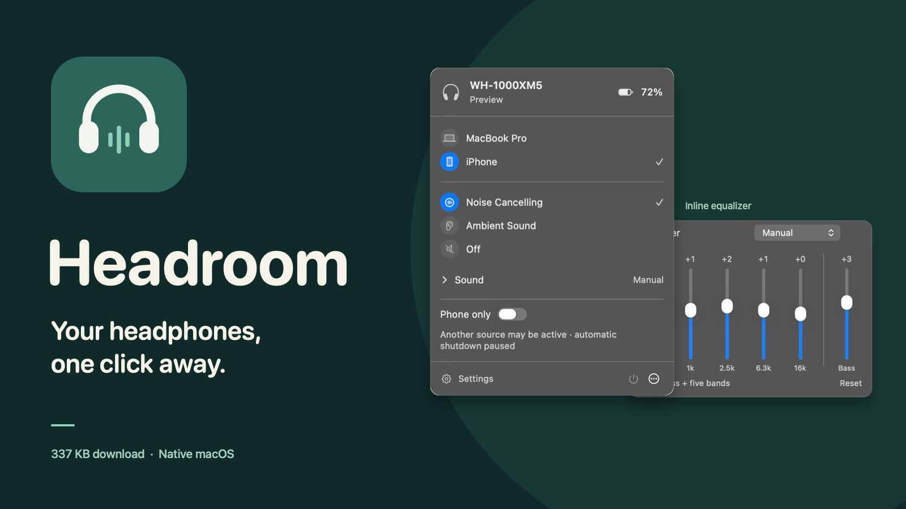

<div align="center">
  
  <h1>Headroom</h1>
  <p><b>Noise control, EQ and smarter Mac ↔ iPhone switching. Right in your menu bar.</b></p>
  <p><b>337 KB download · Native macOS · No dependencies</b></p>
  <a href="https://github.com/Batuhan1999/headroom/releases/latest"></a>
  
  <a href="LICENSE"></a>
</div>

<p align="center">
  
</p>

## Install

```sh
curl -fsSL --retry 3 https://raw.githubusercontent.com/Batuhan1999/headroom/main/install.sh | bash
```

Or [download the app](https://github.com/Batuhan1999/headroom/releases/latest) and move it to Applications. Apple Silicon download; Intel Macs can build from source. Run the same command to update.

Allow Bluetooth on first launch. For smart switching and silence detection, enable audio levels in Settings and allow System Audio Recording. Audio stays in memory; nothing is recorded or uploaded.

## Features

- **Noise control:** ANC, Ambient Sound, ambient level and Focus on Voice.
- **Sound:** EQ presets, compact vertical EQ, DSEE Extreme and Speak-to-Chat.
- **Switching:** source buttons, automatic Mac/iPhone handoff, no audio debounce and Phone Only mode.
- **Backpack protection:** disconnect on lock, sleep or lid close; reconnect after wake.
- **Power:** silence timer, Keep Headphones On and manual shutdown.
- **Extras:** battery alerts, call ambience, mode shortcut, pop-up and Open at Login.

**XM5:** live-tested. **XM6:** experimental, including ten-band EQ; hardware untested. No extra dependency for XM6 support.

The silence timer needs the Mac awake and connected. Calls and unknown playback pause it. The public beta is not notarized.

## Build

Requires Swift 6 and macOS 14.2+.

```sh
git clone https://github.com/Batuhan1999/headroom.git
cd headroom
swift test
bash scripts/build.sh
open dist/Headroom.app
```

[Development, validation and troubleshooting](docs/DEVELOPMENT.md) · [Report an issue](https://github.com/Batuhan1999/headroom/issues)

## Credits

Inspired by [Sound Connect](https://github.com/aecca/sound-connect), with Sony protocol work from [SonyHeadphonesClient](https://github.com/mos9527/SonyHeadphonesClient). Original licenses are in [ThirdParty](ThirdParty).

[MIT](LICENSE). Independent software; not affiliated with Sony.
